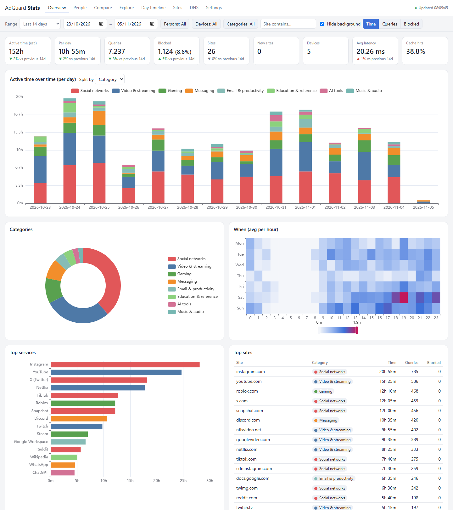
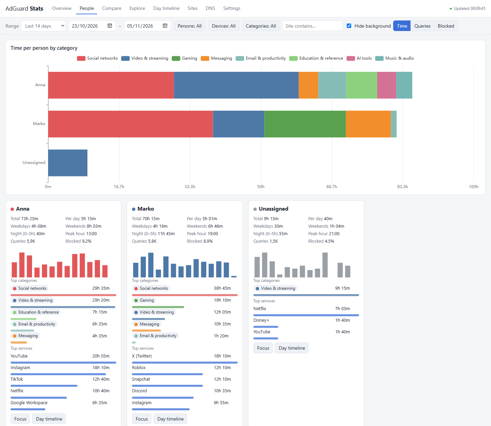
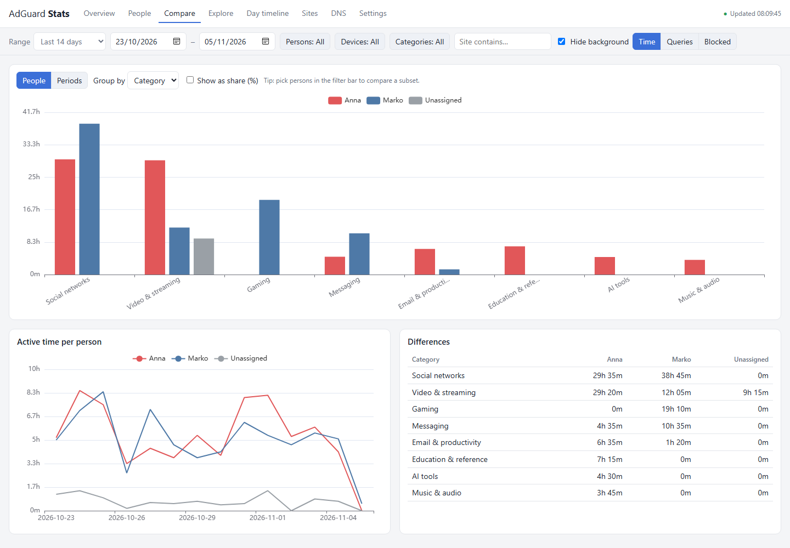
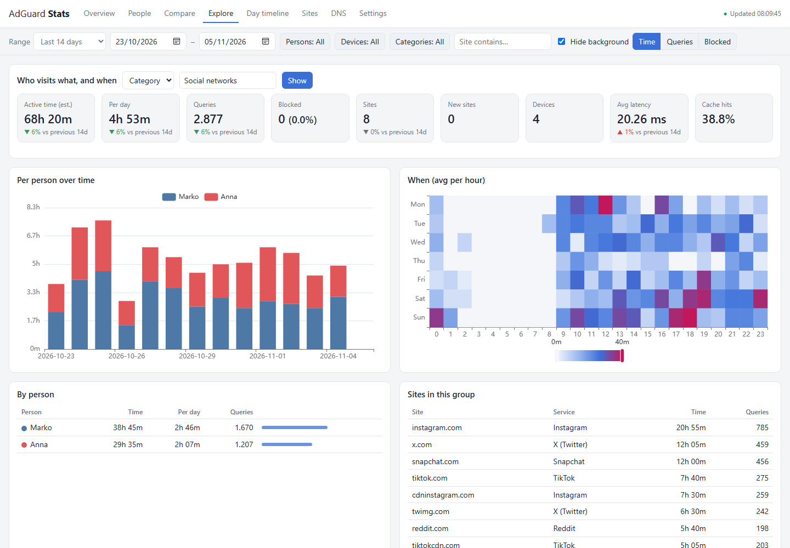
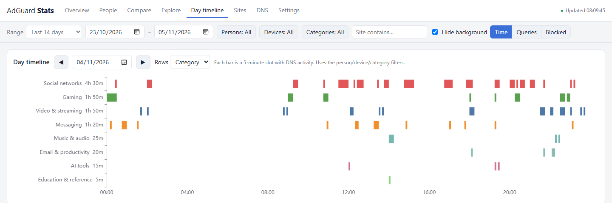
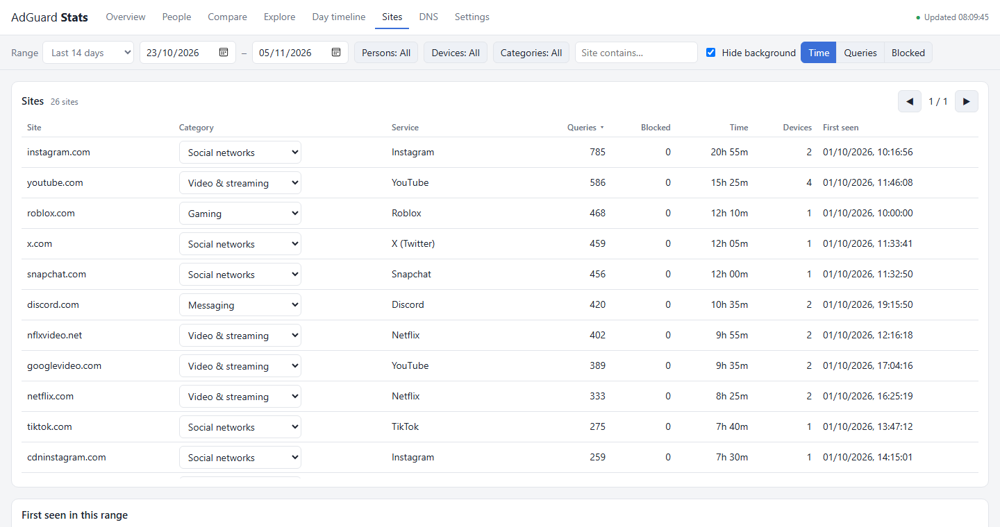
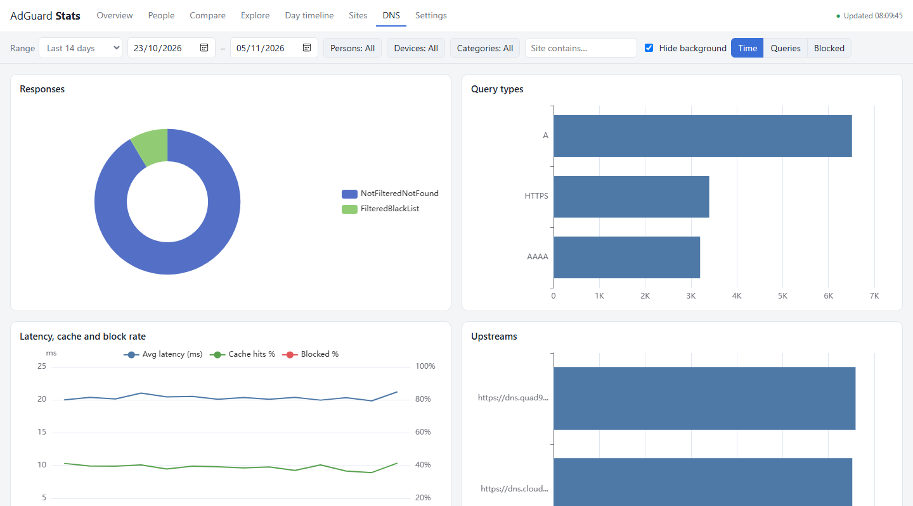
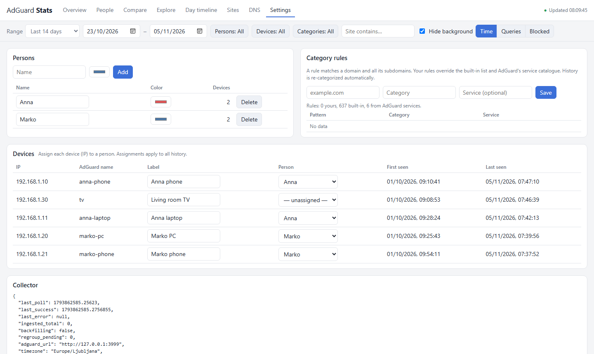
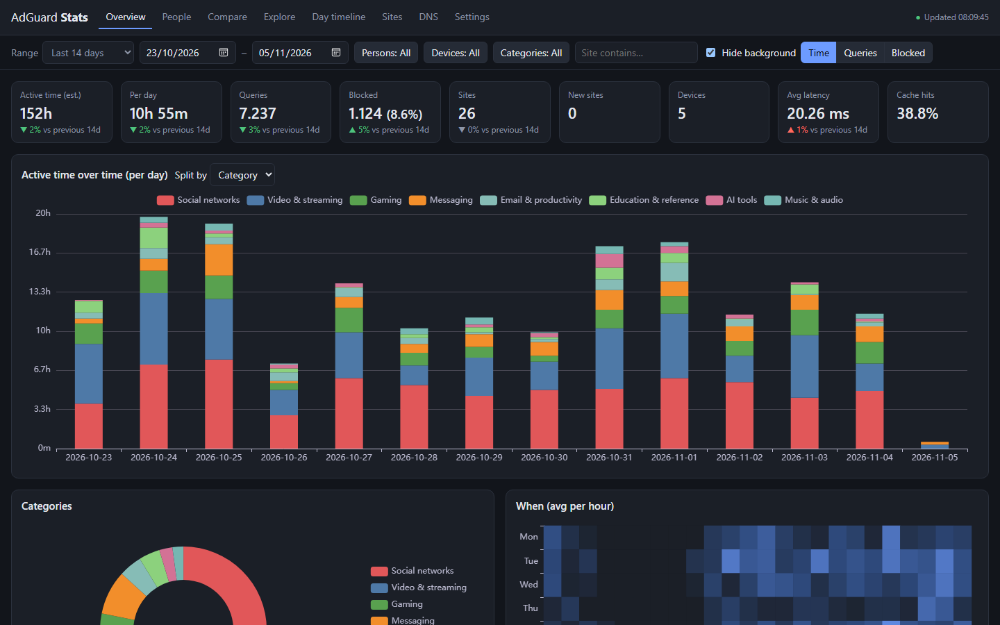

<div align="center">

# AdGuard Stats

**Long-term, per-person browsing statistics for [AdGuard Home](https://github.com/AdguardTeam/AdGuardHome).**

See who uses which sites and categories, when, and roughly for how long, across days, months and years.

[](https://github.com/vaskivskyiI/adguard-stats/actions/workflows/ci.yml)
[](LICENSE)


[](https://ko-fi.com/ivaskivskyi)



</div>

AdGuard Home's own statistics cover a short window and show devices, not people. AdGuard Stats reads
the AdGuard Home query log every minute and folds it into compact SQLite aggregates, so years of
history stay small and fast. The web dashboard groups devices into people and domains into services
and categories.

## Features

- 👪 **People, not IPs.** Assign devices to persons. Assignments apply to all history.
- ⏱️ **Estimated time spent** per person, device, category, service and site (see [How time is estimated](#how-time-is-estimated)).
- 🏷️ **Automatic categories.** About 600 built-in rules (social networks, video, gaming, messaging, AI tools, …),
  plus the service catalogue of your own AdGuard Home. Change any site's category in one click, and
  history is re-categorized.
- 📊 **Compare** people side by side, or this period against the previous one or the same period last year.
- 🔎 **Explore** a category, service or site: who uses it, when, and how that changes over time.
- 🕒 **Day timeline** of 5-minute activity per person or category, and a weekday × hour heatmap.
- 🚨 **Insights:** weekday vs weekend use, night use, peak hours, unusually heavy days, newly seen sites.
- 🛰️ **DNS health:** response types, query types, upstreams, latency, cache-hit and block rates.
- 🗜️ **Built for long ranges.** A year for 10 devices is about 170 MB, and every view loads in under a second.
- 🔒 **Self-hosted**, one container, password-protected, no telemetry, no external services.

## Screenshots

| People | Compare |
|---|---|
|  |  |
| **Explore: who uses social networks, and when** | **Day timeline** |
|  |  |
| **Sites with inline categories** | **DNS health** |
|  |  |
| **Persons, devices and rules** | **Dark mode** |
|  |  |

<sub>Screenshots use the synthetic demo data from <code>scripts/dev.sh</code>.</sub>

### Dashboard tabs

- **Overview**: KPIs compared with the previous period, activity over time split by person, category,
  service, site or device, category donut, weekday × hour heatmap, top services and sites.
- **People**: time per person by category, plus a card per person: daily average, weekdays vs weekends,
  night use (00–05), peak hour, block rate, top categories and services, and unusually heavy days.
- **Compare**: people side by side (absolute values or share of their time), or one period against
  another (previous period, same period last year, or custom), with day-aligned trends.
- **Explore**: pick a category ("Social networks"), service ("YouTube") or site, and see who uses it,
  when (heatmap), the trend per person and which sites it consists of.
- **Day timeline**: one day of 5-minute activity bars per person, category, service, site or device.
- **Sites**: every site with category (editable inline), service, queries, blocked, time, devices and
  first-seen date, plus the sites first seen in the selected range.
- **DNS**: response reasons, query types, upstreams, and daily latency, cache-hit and block rates.
- **Filters** on every tab: range, persons, devices, categories and site text. A switch hides background
  traffic (ads/trackers, CDNs, OS updates, IoT, local names). Metric switch: time, queries or blocked.
  Tabs can be linked directly, e.g. `http://host:8080/#people`.

## Run with podman

Run these on the host that runs podman:

```bash
git clone https://github.com/vaskivskyiI/adguard-stats.git && cd adguard-stats
```

```bash
chmod +x scripts/*.sh && cp .env.example .env && chmod 600 .env
```

Edit `.env`: set `ADGUARD_URL`, `ADGUARD_USER`, `ADGUARD_PASSWORD`, `TZ`, and a `DASHBOARD_PASSWORD`. Then:

```bash
scripts/pod.sh start
```

Open `http://<host>:8080`, go to **Settings**, add persons and assign devices.

| Command | What it does |
|---|---|
| `scripts/pod.sh build` | Build the image `localhost/adguard-stats` |
| `scripts/pod.sh start` | Create pod `adguard-stats` (if needed) and (re)create the container |
| `scripts/pod.sh stop` / `restart` | Stop / restart the pod |
| `scripts/pod.sh update` | Rebuild the image and recreate the container; data is kept |
| `scripts/pod.sh logs` / `status` | Follow logs / show pod and container state |
| `scripts/pod.sh backup` | Write a consistent copy of the database to `./backup-<time>.db` |
| `scripts/pod.sh down` | Remove the pod; the data volume `adguard-stats-data` is kept |
| `scripts/pod.sh install-systemd` | Install Quadlet units (podman ≥ 5) so the pod starts at boot |
| `scripts/pod.sh uninstall-systemd` | Remove the Quadlet units |

For a rootless boot start, also run `loginctl enable-linger $USER` once.

If AdGuard Home runs on the same host, use `ADGUARD_URL=http://host.containers.internal:3000`
(replace the port with your AdGuard web port).

### Behind a reverse proxy

The dashboard works at the domain root or under a path prefix. For nginx under `/stats/`, with
`HOST_PORT=8085` and `HOST_BIND=127.0.0.1` in `.env` (so the port is only reachable through nginx):

```nginx
location = /stats { return 301 /stats/; }
location /stats/ {
    proxy_pass http://127.0.0.1:8085/;   # trailing slash: strips /stats/ before forwarding
    proxy_set_header Host $host;
    proxy_set_header X-Real-IP $remote_addr;
    proxy_set_header X-Forwarded-For $proxy_add_x_forwarded_for;
    proxy_set_header X-Forwarded-Proto $scheme;
}
```

Put the `/stats/` locations before a catch-all `location /` that serves AdGuard Home.

AdGuard Home requirements:
- The query log must be enabled. The collector can only import what the query log still holds, so
  on first start it backfills whatever retention you have configured (for example the last 7 days).
- Client IP anonymization must be off, or every query is attributed to one client.
- The account in `.env` only needs to read the API. You can create a dedicated user in `AdGuardHome.yaml`.

## Configuration (`.env`)

| Variable | Default | Meaning |
|---|---|---|
| `ADGUARD_URL` | `http://127.0.0.1:3000` | AdGuard Home address, as seen from the container |
| `ADGUARD_USER` / `ADGUARD_PASSWORD` | – | AdGuard Home login |
| `ADGUARD_VERIFY_TLS` | `true` | Set to `false` for self-signed HTTPS |
| `TZ` | `UTC` | Time zone for days, heatmaps and timelines |
| `POLL_INTERVAL` | `60` | Seconds between polls |
| `HOURLY_RETENTION_DAYS` | `400` | How long hour-level detail is kept. Daily data is kept forever |
| `DASHBOARD_USER` / `DASHBOARD_PASSWORD` | `admin` / – | HTTP basic auth for the dashboard; an empty password disables it |
| `HOST_BIND` / `HOST_PORT` | `0.0.0.0` / `8080` | Host address and port for the pod (used by `pod.sh`) |

The dashboard shows who visits what. Keep `DASHBOARD_PASSWORD` set, and do not expose the port
to the internet. Basic auth over plain HTTP is only suitable on a trusted LAN or behind a TLS reverse proxy.

## How time is estimated

A device's DNS queries to a site are recorded at 5-minute resolution. If a device queried any domain
of, say, Instagram in a 5-minute slot, that slot counts as 5 minutes on Instagram. For categories,
services and overall time, the slots of all their domains are combined first, so `instagram.com` and
`cdninstagram.com` queried in the same slot count once.

This is an approximation:
- DNS caching on the device hides repeated visits within a record's TTL, so short sessions can be
  undercounted.
- Apps open in the background (messengers, social apps) query periodically, so they can be overcounted.
- Background categories are left out of the overall "active time".
- Time per person adds up the person's devices, so a phone and a laptop in use at the same time count twice.

Treat the numbers as a way to compare people, days and categories, not as exact screen time.

## Storage design

Raw query-log entries are never stored. Each poll folds them into aggregate tables (SQLite, WAL mode):

| Table | Key | Values | Kept |
|---|---|---|---|
| `hourly` | hour, device, site | queries, blocked, 12-bit mask of active 5-min slots | `HOURLY_RETENTION_DAYS` |
| `group_hourly` | hour, device, category / service / all | slot mask (union over the domains in the group) | `HOURLY_RETENTION_DAYS` |
| `daily` | day, device, site | queries, blocked, active slots | forever |
| `group_daily` | day, device, category / service / all | active slots | forever |
| `meta_daily` | day, device, kind, key | query types, response reasons, upstreams, cache hits, latency | forever |

- A "site" is the registrable domain (`scontent-vie1.cdninstagram.com` becomes `cdninstagram.com`), or
  a more specific name when a rule covers it (`mail.google.com` stays apart from `google.com`).
- Persons and categories are joined at query time, so reassigning a device or recategorizing a
  domain takes effect instantly across history. Category and service time older than the hourly
  retention keeps the categories that applied when it was recorded.
- Long ranges are answered from the `daily` tables. Heatmaps, timelines and ranges up to 3 days use the
  hourly tables.
- The query log is read newest first, and each page is committed together with the read position,
  so restarts and AdGuard outages never count a query twice.

Measured: a year of data for 10 devices (about 2.3 M hourly and 0.7 M daily rows, 173 MB) answers every
dashboard query in under 1 s.

## Development

```bash
pip install -r requirements.txt pytest httpx
```

```bash
python -m pytest tests
```

```bash
scripts/dev.sh
```

`scripts/dev.sh` starts a fake AdGuard Home with 3 weeks of synthetic data
(`tests/fake_adguard.py`) and the dashboard on http://127.0.0.1:8080.

Layout: `app/collector.py` (polling and aggregation), `app/api.py` (HTTP API and filters),
`app/categories.py` and `app/data/categories.json` (categorization), `app/db.py` (schema),
`web/` (dashboard, plain JS + ECharts).

## Support the project

If AdGuard Stats is useful to you, you can buy me a coffee on Ko-fi. It keeps the project going:

<a href="https://ko-fi.com/ivaskivskyi"></a>

A star on GitHub also helps others find it. Bug reports, category rules and pull requests are
welcome; see [CONTRIBUTING.md](CONTRIBUTING.md).

## License

[MIT](LICENSE) © Igor Vaskivskyi. Third-party components are listed in [THIRD_PARTY_NOTICES.md](THIRD_PARTY_NOTICES.md).
Not affiliated with or endorsed by AdGuard.
